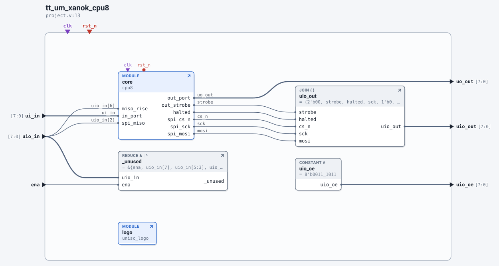
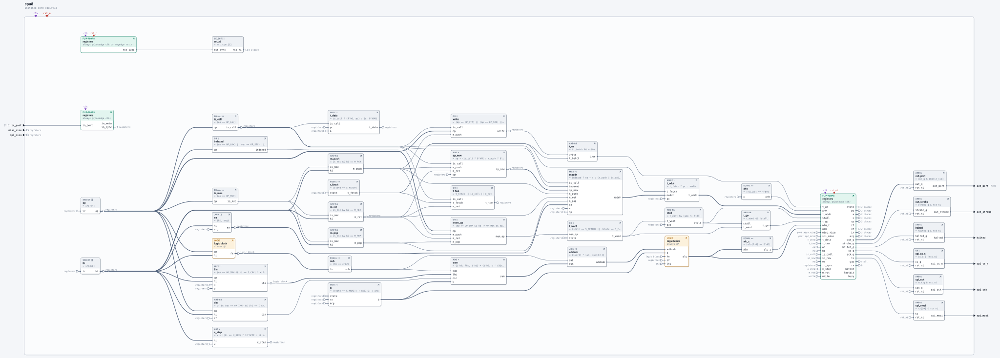
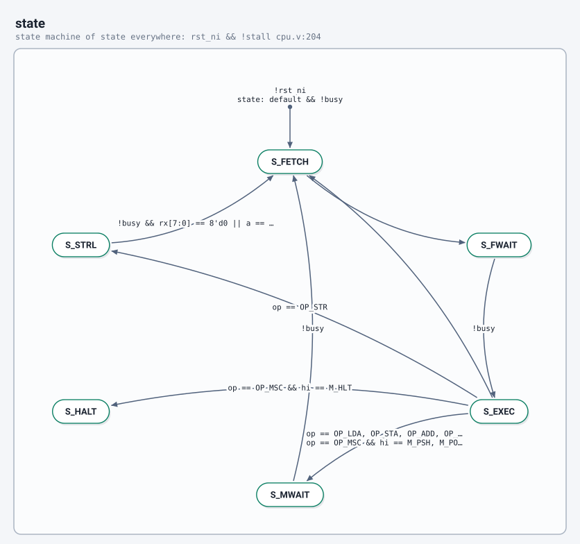
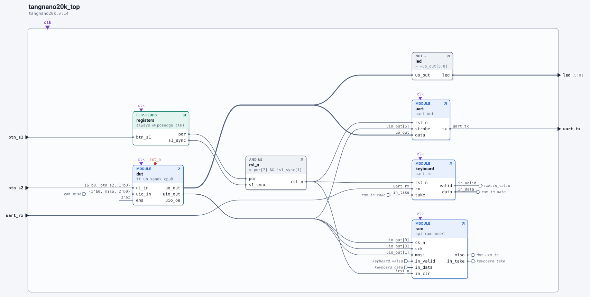
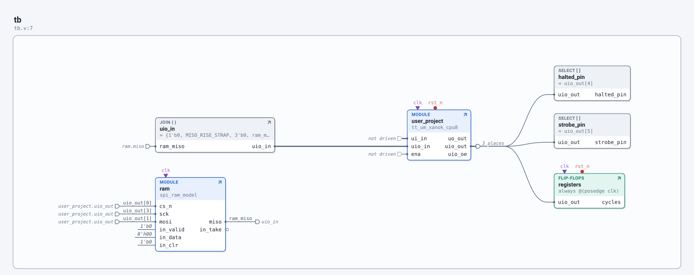

# Schematics

Interactive schematics of the Verilog. **Open them in the browser: [xanok.github.io/tt-cpu/schematics](https://xanok.github.io/tt-cpu/schematics/).** Each page is also a single HTML file in [`schematics/`](../schematics/) that works offline (GitHub's file view shows only its HTML source).

| Page | Top module | What it shows |
|------|------------|---------------|
| [chip](https://xanok.github.io/tt-cpu/schematics/chip.html) | `tt_um_xanok_cpu8` | the chip as submitted: the Tiny Tapeout wrapper, the CPU core `cpu8` and the logo |
| [Tang Nano 20K](https://xanok.github.io/tt-cpu/schematics/tangnano20k.html) | `tangnano20k_top` | the Tang Nano 20K system: the chip, the SPI RAM as block RAM, the UART output and keyboard input |
| [bench test FPGA](https://xanok.github.io/tt-cpu/schematics/tangnano20k_chip.html) | `tangnano20k_chip` | the FPGA build that plays the chip in the [bench test](bench.md) |
| [testbench](https://xanok.github.io/tt-cpu/schematics/testbench.html) | `tb` | the cocotb testbench (`test/tb.v`): the chip wired to the SPI RAM model |
| [gate-level netlist](https://xanok.github.io/tt-cpu/schematics/gate_level.html) | `tt_um_xanok_cpu8` | the routed gate-level netlist of the local GF180 hardening used for the timing simulation ([test/README.md](../test/README.md)); its 3,334 cells are drawn as 47 groups |

The pictures below are views of these pages; click one to open the page at that view.

### The chip

[](https://xanok.github.io/tt-cpu/schematics/chip.html)

### The CPU core

[](https://xanok.github.io/tt-cpu/schematics/chip.html#tt_um_xanok_cpu8/core)

### The CPU state machine

[](https://xanok.github.io/tt-cpu/schematics/chip.html#tt_um_xanok_cpu8/core/!state)

### The Tang Nano 20K top

[](https://xanok.github.io/tt-cpu/schematics/tangnano20k.html)

### The testbench

[](https://xanok.github.io/tt-cpu/schematics/testbench.html)

## Reading a page

- The page opens on the top module. Inputs are on the left, outputs on the right, clock and reset on top.
- Click a block to open it: a module shows its inside, an `always` block its registers with the conditions and values they get, an `assign` its operators. `Esc` goes back up.
- Lines join near blocks. A connection that would be too long ends in a small flag that names the other end; click the flag to go there.
- Hover over a pin or line to see where the signal comes from and where it goes; click it to keep it lit. The panel on the right then offers the same signal one level up and down, and **Show only its cone**: just the logic that drives it.
- The panel of `cpu8` lists its state machine: click **state** for the diagram of `S_FETCH`, `S_FWAIT`, `S_EXEC`, `S_MWAIT`, `S_STRL` and `S_HALT`.
- Zoom with the scroll wheel; **Fit** shows all; **SVG** and **PNG** save the open view as a picture.

## Values from a simulation

`testbench.html` matches the scope names of the cocotb test, so it can show the values of a test run on the drawing:

```sh
cd test && make PROGRAMS=hello            # writes tb.fst
fst2vcd tb.fst > tb.vcd                   # the page reads VCD (fst2vcd comes with GTKWave)
```

Open `testbench.html`, click **Values** and choose `tb.vcd` (or drop it on the drawing). Every line shows its value at the chosen time, single bits that are 1 are drawn in colour, and the state diagram marks the current state. The slider sets the time; the arrows step to the previous or next change of a signal in the open view. A run of all tests makes a VCD of about 270 MB, which loads slowly; one program is enough to look around.

## Making them again

The pages are made with vlogview, a Verilog-to-schematic tool, from the files in `src/`, `fpga/`, `model/` and `test/`. After a change to the Verilog:

```sh
schematics/make.sh        # needs vlogview on the PATH
```

vlogview itself is not public; the pages carry its viewer in compressed form.

`make.sh` also makes the SVG pictures above again (`schematics/pictures.py`, needs Chrome). The pages are published to GitHub Pages by the `viewer` job of the GDS workflow, next to the 3D viewer of the layout.

`gate_level.html` is only made again when `test/gate_level_netlist.v` is there (it comes from a hardening run, see [test/README.md](../test/README.md)).
